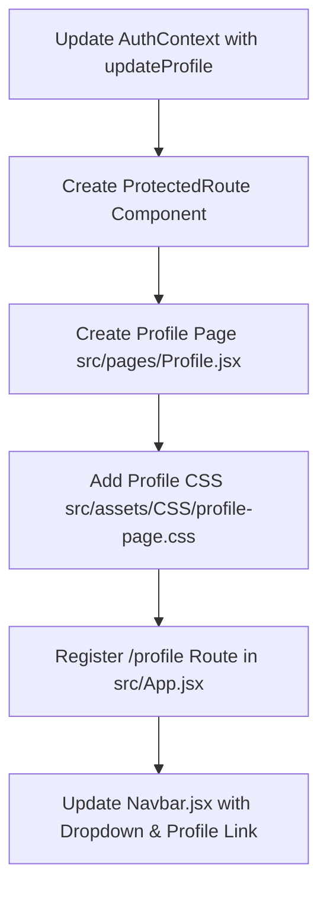

# User Profile Implementation Guide

This document provides a comprehensive, step-by-step blueprint to implement the **User Profile** feature in the **ML Studio Frontend** project.

---

## 1. Project Health & Current Architecture Check

### Current Stack & Setup
- **Framework**: React 19 + Vite 8
- **Routing**: `react-router-dom` (v6 `HashRouter`)
- **Styling**: Bootstrap 5.3.8 + Bootstrap Icons + FontAwesome Free + Custom CSS (`src/assets/CSS/`)
- **State Management**: React Context API (`AuthContext`, `CartContext`)

### Existing Auth Flow (`src/context/AuthContext.jsx` & `src/data/account.js`)
- Users log in via [LoginModal.jsx](file:///Users/menghuylor/Desktop/Old-Project/ML-Studio-Frontend/src/components/LoginModal.jsx) using the credentials defined in [account.js](file:///Users/menghuylor/Desktop/Old-Project/ML-Studio-Frontend/src/data/account.js).
- User session is saved in `localStorage.getItem('currentUser')`.
- [Navbar.jsx](file:///Users/menghuylor/Desktop/Old-Project/ML-Studio-Frontend/src/components/Navbar.jsx) currently displays the logged-in user's name:
  ```jsx
  <span className="fw-bold me-2 text-white" style={{ fontSize: '0.95rem' }}>
    <i className="fa-solid fa-user me-1 text-warning"></i>
    {currentUser.name}
  </span>
  ```
- **Current Limitation**: Clicking the user name does nothing; there is no profile route, no profile view/edit screen, and no way to update user details, manage addresses, or view past orders.

---

## 2. Target Features for User Profile

1. **Profile Navigation**: User dropdown menu in the Navbar (Profile, Orders, Settings, Logout).
2. **Protected Route**: `/profile` path accessible only when authenticated (redirects or prompts login).
3. **Tabbed Profile Sections**:
   - **Overview / Personal Info**: View and edit avatar, full name, email, phone number, bio.
   - **Addresses**: Manage shipping & billing addresses (add, edit, delete, set default).
   - **Order History**: List of past orders with items, status badges, totals, and timestamps.
   - **Security Settings**: Password change simulation and session status.
4. **State Persistence**: Sync updates to `localStorage` through `AuthContext.updateProfile()`.

---

## 3. Implementation Steps



---

### Step 1: Extend `AuthContext.jsx`

Add `updateProfile` and `changePassword` functions to [AuthContext.jsx](file:///Users/menghuylor/Desktop/Old-Project/ML-Studio-Frontend/src/context/AuthContext.jsx).

```jsx
// Additions inside AuthProvider in src/context/AuthContext.jsx:

const updateProfile = useCallback((updatedFields) => {
  setCurrentUser((prev) => {
    if (!prev) return null;
    const updated = { ...prev, ...updatedFields };
    localStorage.setItem('currentUser', JSON.stringify(updated));
    return updated;
  });
  return { success: true };
}, []);

const changePassword = useCallback((currentPassword, newPassword) => {
  // Validate against current password stored or mock
  if (currentPassword !== account.password) {
    return { success: false, error: 'Current password is incorrect.' };
  }
  account.password = newPassword;
  return { success: true };
}, []);

// Expose updateProfile and changePassword in the value object:
const value = useMemo(
  () => ({
    currentUser,
    isLoggedIn: !!currentUser,
    login,
    logout,
    updateProfile,
    changePassword,
  }),
  [currentUser, login, logout, updateProfile, changePassword]
);
```

---

### Step 2: Create a Protected Route Wrapper

Create `src/components/ProtectedRoute.jsx` to guard the profile page from unauthenticated access:

```jsx
import { useContext } from 'react';
import { Navigate, useLocation } from 'react-router-dom';
import { AuthContext } from '../context/AuthContext';

export default function ProtectedRoute({ children }) {
  const { isLoggedIn } = useContext(AuthContext);
  const location = useLocation();

  if (!isLoggedIn) {
    // Redirect to home with redirect intent
    return <Navigate to="/" state={{ from: location, openLogin: true }} replace />;
  }

  return children;
}
```

---

### Step 3: Create Profile Page Component (`src/pages/Profile.jsx`)

Create `src/pages/Profile.jsx` with tabs for **Account Details**, **Addresses**, and **Security**:

```jsx
import { useState, useContext } from 'react';
import { AuthContext } from '../context/AuthContext';

export default function Profile() {
  const { currentUser, updateProfile, logout } = useContext(AuthContext);

  const [activeTab, setActiveTab] = useState('profile');
  const [formData, setFormData] = useState({
    name: currentUser?.name || '',
    email: currentUser?.email || '',
    phone: currentUser?.phone || '+855 12 345 678',
    bio: currentUser?.bio || 'Product designer & ML enthusiast',
    address: currentUser?.address || 'Street 271, Phnom Penh, Cambodia',
  });
  const [toastMessage, setToastMessage] = useState('');

  const handleChange = (e) => {
    const { name, value } = e.target;
    setFormData((prev) => ({ ...prev, [name]: value }));
  };

  const handleSave = (e) => {
    e.preventDefault();
    updateProfile(formData);
    setToastMessage('Profile updated successfully!');
    setTimeout(() => setToastMessage(''), 3000);
  };

  return (
    <div className="profile-container py-5">
      <div className="container">
        {/* Header Breadcrumb */}
        <div className="mb-4">
          <h2 className="fw-bold">My Account</h2>
          <p className="text-muted">Manage your personal information, address, and security settings.</p>
        </div>

        {toastMessage && (
          <div className="alert alert-success alert-dismissible fade show" role="alert">
            <i className="bi bi-check-circle-fill me-2"></i>
            {toastMessage}
          </div>
        )}

        <div className="row g-4">
          {/* Sidebar Navigation */}
          <div className="col-lg-3">
            <div className="card shadow-sm border-0 rounded-3 p-3">
              <div className="text-center py-3 border-bottom">
                <div className="avatar-wrapper mb-3 position-relative d-inline-block">
                  <div
                    className="avatar-circle bg-primary text-white d-flex align-items-center justify-content-center mx-auto"
                    style={{ width: '90px', height: '90px', borderRadius: '50%', fontSize: '2rem' }}
                  >
                    {currentUser?.name?.charAt(0)?.toUpperCase() || 'U'}
                  </div>
                </div>
                <h5 className="mb-0 fw-bold">{currentUser?.name}</h5>
                <small className="text-muted">{currentUser?.email}</small>
              </div>

              <div className="list-group list-group-flush pt-3">
                <button
                  type="button"
                  className={`list-group-item list-group-item-action border-0 rounded-2 mb-1 ${activeTab === 'profile' ? 'active' : ''}`}
                  onClick={() => setActiveTab('profile')}
                >
                  <i className="bi bi-person me-2"></i> Profile Details
                </button>
                <button
                  type="button"
                  className={`list-group-item list-group-item-action border-0 rounded-2 mb-1 ${activeTab === 'orders' ? 'active' : ''}`}
                  onClick={() => setActiveTab('orders')}
                >
                  <i className="bi bi-bag-check me-2"></i> Order History
                </button>
                <button
                  type="button"
                  className={`list-group-item list-group-item-action border-0 rounded-2 mb-1 ${activeTab === 'security' ? 'active' : ''}`}
                  onClick={() => setActiveTab('security')}
                >
                  <i className="bi bi-shield-lock me-2"></i> Security
                </button>
                <button
                  type="button"
                  className="list-group-item list-group-item-action border-0 rounded-2 text-danger mt-2"
                  onClick={logout}
                >
                  <i className="bi bi-box-arrow-right me-2"></i> Logout
                </button>
              </div>
            </div>
          </div>

          {/* Main Content Area */}
          <div className="col-lg-9">
            <div className="card shadow-sm border-0 rounded-3 p-4">
              {activeTab === 'profile' && (
                <form onSubmit={handleSave}>
                  <h4 className="fw-bold mb-4">Edit Profile</h4>
                  <div className="row g-3">
                    <div className="col-md-6">
                      <label className="form-label fw-semibold">Full Name</label>
                      <input
                        type="text"
                        name="name"
                        className="form-control"
                        value={formData.name}
                        onChange={handleChange}
                        required
                      />
                    </div>
                    <div className="col-md-6">
                      <label className="form-label fw-semibold">Email Address</label>
                      <input
                        type="email"
                        name="email"
                        className="form-control"
                        value={formData.email}
                        onChange={handleChange}
                        required
                      />
                    </div>
                    <div className="col-md-6">
                      <label className="form-label fw-semibold">Phone Number</label>
                      <input
                        type="tel"
                        name="phone"
                        className="form-control"
                        value={formData.phone}
                        onChange={handleChange}
                      />
                    </div>
                    <div className="col-md-6">
                      <label className="form-label fw-semibold">Shipping Address</label>
                      <input
                        type="text"
                        name="address"
                        className="form-control"
                        value={formData.address}
                        onChange={handleChange}
                      />
                    </div>
                    <div className="col-12">
                      <label className="form-label fw-semibold">Bio / Notes</label>
                      <textarea
                        name="bio"
                        rows="3"
                        className="form-control"
                        value={formData.bio}
                        onChange={handleChange}
                      ></textarea>
                    </div>
                  </div>
                  <button type="submit" className="btn btn-dark mt-4 px-4 py-2">
                    Save Changes
                  </button>
                </form>
              )}

              {activeTab === 'orders' && (
                <div>
                  <h4 className="fw-bold mb-4">Order History</h4>
                  <p className="text-muted">No recent orders found for this account.</p>
                </div>
              )}

              {activeTab === 'security' && (
                <div>
                  <h4 className="fw-bold mb-4">Security Settings</h4>
                  <p className="text-muted">Manage your password and authentication credentials.</p>
                </div>
              )}
            </div>
          </div>
        </div>
      </div>
    </div>
  );
}
```

---

### Step 4: Add Profile Styles (`src/assets/CSS/profile-page.css`)

Create `src/assets/CSS/profile-page.css` and import it in [src/index.css](file:///Users/menghuylor/Desktop/Old-Project/ML-Studio-Frontend/src/index.css):

```css
/* src/assets/CSS/profile-page.css */
.profile-container {
  background-color: #f8f9fa;
  min-height: calc(100vh - 180px);
}

.profile-container .card {
  background: #ffffff;
}

.profile-container .list-group-item.active {
  background-color: #212529;
  border-color: #212529;
  color: #fff;
}

.avatar-circle {
  font-weight: 600;
  box-shadow: 0 4px 10px rgba(0, 0, 0, 0.15);
}
```

In [src/index.css](file:///Users/menghuylor/Desktop/Old-Project/ML-Studio-Frontend/src/index.css), add:
```css
@import "./assets/CSS/profile-page.css";
```

---

### Step 5: Register Route in `src/App.jsx`

Add lazy loading and route definition in [src/App.jsx](file:///Users/menghuylor/Desktop/Old-Project/ML-Studio-Frontend/src/App.jsx):

```jsx
const Profile = lazy(() => import('./pages/Profile'));

// Inside Routes:
<Route
  path="profile"
  element={
    <ProtectedRoute>
      <Profile />
    </ProtectedRoute>
  }
/>
```

---

### Step 6: Connect User Profile Dropdown in `src/Navbar.jsx`

Replace the plain username display in [src/components/Navbar.jsx](file:///Users/menghuylor/Desktop/Old-Project/ML-Studio-Frontend/src/components/Navbar.jsx) with a dropdown containing links to the Profile and Logout:

```jsx
{isLoggedIn ? (
  <div className="dropdown d-inline-block me-2">
    <button
      className="btn btn-outline-light dropdown-toggle d-flex align-items-center gap-2"
      type="button"
      id="userDropdown"
      data-bs-toggle="dropdown"
      aria-expanded="false"
      style={{ fontSize: '0.9rem' }}
    >
      <i className="fa-solid fa-circle-user fa-lg text-warning"></i>
      <span>{currentUser.name}</span>
    </button>
    <ul className="dropdown-menu dropdown-menu-end shadow" aria-labelledby="userDropdown">
      <li>
        <Link className="dropdown-item py-2" to="/profile">
          <i className="bi bi-person me-2"></i> My Profile
        </Link>
      </li>
      <li><hr className="dropdown-divider" /></li>
      <li>
        <button className="dropdown-item text-danger py-2" onClick={logout}>
          <i className="bi bi-box-arrow-right me-2"></i> Logout
        </button>
      </li>
    </ul>
  </div>
) : (
  // Existing Login/Register buttons
)}
```

---

## 4. Testing Checklist

| Task | Test Action | Expected Result |
|---|---|---|
| **Access Control** | Navigate directly to `/#/profile` while logged out | Redirected to home page / prompted to log in |
| **Login Redirect** | Log in with demo account (`menghuy` / `12345`) | User dropdown appears in Navbar with name |
| **Profile Navigation** | Click "My Profile" in the Navbar dropdown | Navigates to `/profile` displaying user details |
| **Edit & Save** | Edit name, phone, or bio and click "Save Changes" | Updates persist in `localStorage` and Navbar updates immediately |
| **Logout** | Click "Logout" from dropdown or profile sidebar | Session is cleared, redirected to public view |

---

## 5. Next Steps / Backend Integration (When Ready)

When transitioning from the demo mock storage to a production backend:
1. Replace `localStorage.setItem('currentUser')` with an API call:
   ```javascript
   await fetch('/api/user/profile', {
     method: 'PUT',
     headers: { Authorization: `Bearer ${token}`, 'Content-Type': 'application/json' },
     body: JSON.stringify(formData),
   });
   ```
2. Add image upload support (Multipart/Form-Data or S3/Cloudinary presigned URLs) for user profile avatars.
3. Fetch real orders from `/api/orders` to populate the "Order History" tab.
